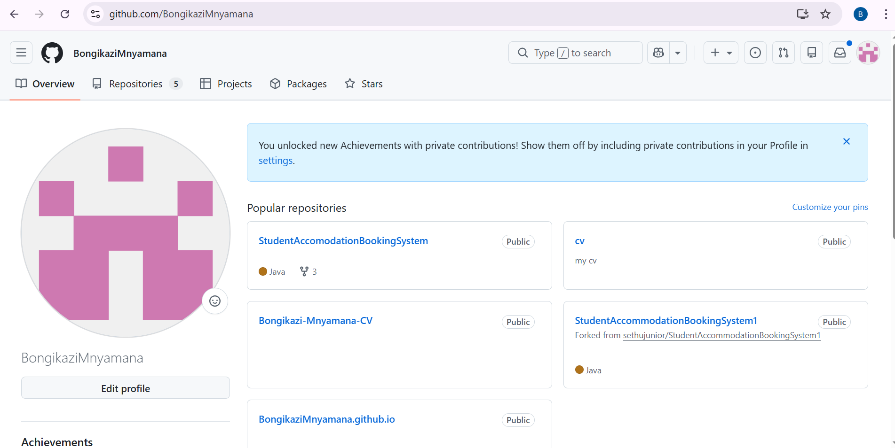
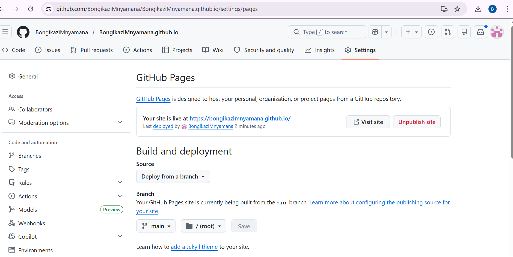

# Bongikazi Mnyamana – Digital Portfolio

## Table of Contents
1. [Profile and CV](#cv)
2. [CV Coded Using Markdown – Reflection](#cv-reflection)
3. [Mock Interview Video](#mock-interview)
4. [Published on GitHub Pages](#github-pages)
5. [Agile Team Charter](#agile-team-charter)
6. [User Stories and Tasks](#user-stories-and-tasks)
7. [Product Backlog](#product-backlog)
8. [Sprint Backlog](#sprint-backlog)
9. [Agile Logbook](#agile-logbook)
10. [Portfolio Summary](#portfolio-summary)

---

## GitHub Student Account

**Username:** BongikaziMnyamana  
**GitHub Profile:** [github.com/BongikaziMnyamana](https://github.com/BongikaziMnyamana)

# Bongikazi Malebu Mnyamana

📧 222718404@mycput.ac.za  
📞 +27 69 533 0914  
📍 Cape Town, South Africa  
🌐 https://github.com/BongikaziMnyamana  
🔗 https://www.linkedin.com/in/bongikazi-mnyamana  

---

## 🎓 Education

**National Senior Certificate (Grade 12)** *(2021)*  
Cofimvaba High School, Eastern Cape  

**Higher Certificate in Information & Communication Technology**  
Cape Peninsula University of Technology  

**Diploma in Information and Communication Technology (Application Development)** *(Current)*  
Cape Peninsula University of Technology, Cape Town  

---

## 💻 Technical Skills

**Programming Languages:**  
Java, Python, JavaScript  

**Web Technologies:**  
HTML, CSS  

**Databases:**  
MySQL, Derby  

**Tools & Technologies:**  
Git, GitHub, NetBeans, Node.js  

---

## 💼 Projects

### NGO Management System *(Personal Project)*
- Developed a Java desktop application with MySQL integration using JDBC  
- Implemented secure authentication and full CRUD operations  
- Built modules for member, donation, volunteer, and beneficiary management  

---

### CPUT StudyConnect *(Group Project)*
- Developed a Java Swing desktop application to help students create and join study sessions  
- Built GUI interfaces using JTable and applied OOP and MVC architecture  
- Developed Study Sessions and Ratings modules with Derby SQL and CRUD functionality  

---

### GugsLocalConnect *(Group Project – Agile)*
- Worked as **Agile Lead** in a team of six on a community platform connecting Gugulethu residents with local businesses  
- Planned work in several sprints and tracked tasks on a Trello board  
- Live application: https://gug-local-connect1-ashen.vercel.app/  

---

### Personal Portfolio Website *(Web Development Project)*
- Designed and developed a responsive website using HTML, CSS, and JavaScript  
- Implemented interactive features and form validation  
- Focused on usability and responsive design  

---

## 📞 References

**Ms S’nazo Kamteni**  
Sport Coach  
📞 +27 71 120 2142  
✉️ snazok@gmail.com  

**Mr Deric Sicetsha**  
Pastor  
📞 +27 63 081 3190  
✉️ esethudericsicetsha@gmail.com  

---

## CV Coded Using Markdown Language Reflection

**Situation:**
As part of my PRP370 module, I was required to create a professional CV using 
Markdown language. This was my first time writing in Markdown, and I had no 
prior experience with its syntax or formatting conventions.

**Task:**
My task was to produce a well-structured, visually clear CV that showcased my 
education, technical skills, and projects all coded in Markdown 
rather than a traditional word processor.

**Action:**
I researched Markdown syntax, learning how to use headings (`#`), bold text 
(`**`), bullet points (`-`), horizontal rules (`---`), and inline formatting 
for links and icons. I structured the CV with clear sections and used emojis 
as visual anchors to make each section easy to identify. I also linked my 
GitHub and LinkedIn profiles directly in the header.

**Result:**
I successfully produced a complete, professional CV in Markdown. I gained a 
new technical skill that is widely used in the software development industry — 
particularly for README files and documentation on GitHub. The experience 
improved my attention to formatting detail and gave me confidence in writing 
structured content using lightweight markup languages.

---

## Mock Interview Video

  

## Mock Interview Video Reflection

**Situation:**
As part of the assessment, I was required to record a mock interview video. 
I had to select interview questions that I felt comfortable answering, which 
gave me the opportunity to present myself authentically.

**Task:**
My task was to choose suitable interview questions, prepare thoughtful answers, 
and record a video that demonstrated my ability to communicate professionally 
and present my skills and background confidently.

**Action:**
I selected questions that aligned with my personal experiences and technical 
background, such as questions about my projects, my strengths, and why I chose 
application development. I prepared and practised my answers beforehand to 
ensure I spoke clearly and with confidence. I then recorded and embedded the 
video using Markdown/HTML as required.

**Result:**
The experience was both challenging and valuable. Recording myself helped me 
identify areas where I tend to rush or lose confidence, and practising 
beforehand made a noticeable difference. I came away with a better 
understanding of how to present myself in a professional interview setting, 
and the exercise built my self-awareness as a future job candidate in the 
IT industry.

---

## Published on GitHub Pages Evidence

My digital portfolio is live and published on GitHub Pages:

**Live Site:** [https://bongikazimnyamana.github.io/](https://bongikazimnyamana.github.io/)

## Published on GitHub Pages Reflection

**Situation:**
This was my first time using GitHub, and I was required to not only create a 
GitHub account but also publish my digital portfolio on GitHub Pages. I had 
no prior experience with version control or deploying web content through 
GitHub.

**Task:**
My task was to set up a GitHub student account, upload my portfolio content, 
and successfully publish it as a live website using GitHub Pages.

**Action:**
I started by creating my GitHub account and familiarising myself with the 
platform's interface. I learned how to create a repository, commit and push 
files, and configure the repository settings to enable GitHub Pages. I worked 
through errors and settings step by step, using available resources to guide 
me through the deployment process.

**Result:**
I successfully published my digital portfolio on GitHub Pages. This was a 
significant achievement for me as a first-time GitHub user. Beyond completing 
the requirement, I now have a live, accessible portfolio that I can share with 
future employers. The experience introduced me to industry-standard version 
control practices and gave me a foundation to continue using GitHub for future 
academic and professional projects.

---

# Semester 2- Entrepreneurial WIL Project: GugsLocalConnect

## Project Context
GugsLocalConnect is a community platform that connects residents of Gugulethu with trusted local businesses and service providers. Our team of six worked in Agile sprints and managed the work on a Trello board. **My role was Agile Lead**, responsible for facilitating Agile meetings and encouraging teamwork and communication.

**Project Evidence:**
- Task board (Trello): https://trello.com/b/HIAaT2dR/gugslocalconnect-task-board
- Live application: https://gug-local-connect1-ashen.vercel.app/
- Frontend repository: https://github.com/BongikaziMnyamana/GugLocalConnect1

---

## Agile Team Charter

### Evidence
[View my Agile Team Charter)](https://github.com/BongikaziMnyamana/BongikaziMnyamana.github.io/blob/main/PRP3_TEAM_CHARTER..docx)

The charter sets out the purpose of GugsLocalConnect, the six team roles, our core values (collaboration, respect, transparency, accountability and continuous improvement), a communication plan (daily stand-ups, a weekly sprint review and a sprint retrospective), a SMART goal and a 14-week milestone plan.

### Reflection
**Situation:** Our team of six was starting the GugsLocalConnect project and needed a shared agreement on how we would work together, who was responsible for what, and how we would communicate.

**Task:** As Agile Lead, my task was to help the team follow the agreements in the charter, especially the meeting routine (daily stand-ups, weekly reviews and retrospectives) and keeping the Trello board updated at the end of each working day.

**Action:** I helped organise and facilitate our team meetings on Microsoft Teams and used the WhatsApp group for quick updates and reminders.

**Result:** The charter gave the team a common direction and clear expectations for roles and communication.

**Learning and next time:** I learned that agreements only work if someone checks that they are being followed. If I wrote the charter again, I would make the agreements easier to keep, for example by agreeing stand-up times that fit around everyone's timetables.

---

## User Stories and Tasks

### Evidence

[View our Trello board](https://trello.com/b/HIAaT2dR/gugslocalconnect-task-board)

Our team used Trello to record our user stories and turn each one into smaller tasks. Each task had a checklist and was given to a team member, so we knew who was responsible and what still needed to be done. This helped us keep our work focused on what customers and business owners needed from GugsLocalConnect. Our two main user stories were:

1. As a **customer**, I want to browse local businesses and contact business owners, so that I can find trusted services in my community.
   - Related tasks: search functionality, category filtering, contact business feature
2. As a **business owner**, I want to manage my business profile and services, so that customers can find my business online.
   - Related tasks: business profile management, service listing feature

### Reflection
**Situation:** Our team needed to understand what users needed from the platform and divide the work in a way everyone could follow.

**Task:** As Agile Lead, I wanted to make sure the work was clear enough that every team member knew what they were responsible for.

**Action:** We described features as user stories and split each one into smaller tasks with checklists on Trello, assigned to team members.

**Result:** The checklists made progress easy to see, and most cards showed 6/6 or 4/4 once complete.

**Learning and next time:** I learned that a story is only useful if its tasks are small and specific. Next time I would write acceptance criteria for each story so that everyone agrees what "done" means.

---

## Product Backlog

### Evidence

Our product backlog on Trello holds all the features and testing work we needed to build GugsLocalConnect, grouped by sprint. The core features (business profiles, service listings, search, category filtering and contacting a business) were planned for Sprint 8, and testing and deployment for Sprint 9. Completed items are marked with a green tick, which let the team see what was done and what was left. Our charter set the goal of completing all 28 backlog tasks.

**Sprint 8 – Core Features**
1. Implement business profile management
2. Implement service listing feature
3. Implement search functionality
4. Implement category filtering
5. Implement contact business feature

**Sprint 9 – Testing and Deployment**
6. Perform unit testing
7. Perform integration testing
8. Further testing and deployment tasks (see screenshot)

### Reflection
**Situation:** The project had many requirements across research, design, frontend and backend work, and we could not do everything at once.

**Task:** As Agile Lead, I needed to help the team keep a clear, shared view of what had to be done and in what order.

**Action:** We kept all work as cards on Trello and grouped it by sprint, with the core features (business profiles, service listings, search, category filtering and contacting a business) built in Sprint 8, followed by testing and deployment in Sprint 9.

**Result:** The backlog gave the team one place to see all the work, which made planning each sprint easier.

**Learning and next time:** I learned that the backlog needs regular review as requirements change. Next time I would review and re-order the backlog at every sprint review.

---

## Sprint Backlog

### Evidence

Our team used sprints on Trello to split the project into stages, such as Business Planning, Requirements Analysis, System Design and UI/UX Design. Each card had a checklist and the team members assigned to it, which let us follow progress and see who was responsible. The board also showed where work was behind, for example two Sprint 3 requirements cards that had no completed tasks yet. The sprints shown in the evidence are:

- **Sprint 1 – Research and Problem Identification:** collect survey responses, identify community stakeholders, define the community problem
- **Sprint 2 – Business Planning:** define project objectives, value proposition, research competitors, SWOT analysis, business model
- **Sprint 3 – Requirements Analysis:** gather functional and non-functional requirements, identify system users
- **Sprint 4 – System Design:** class diagram, ERD, system flow diagram, database schema, API requirements
- **Sprint 5 – UI/UX Design:** Figma project, landing page, login and registration pages
- **Sprint 6 – Frontend Development:** set up Angular, navigation, landing page, registration
- **Sprint 8 – Core Features:** business profile management, service listing, search, category filtering, contact business
- **Sprint 9 – Testing and Deployment:** unit testing, integration testing

### Reflection
**Situation:** Our team needed to break a large project into stages we could plan and finish one at a time.

**Task:** As Agile Lead, I needed to help the team plan each sprint and keep the board accurate so everyone could see progress.

**Action:** We grouped tasks by sprint, assigned them to team members and tracked checklist progress on Trello.

**Result:** Most cards were completed, but the board also showed work that was not finished, for example the Sprint 3 cards "Define business owner requirements" (0/1) and "Define customer requirements" (0/7).

**Learning and next time:** I learned that a sprint plan needs regular checking, because tasks can take longer than expected or depend on other work. Next time I would check the board before each stand-up and move late cards into the next sprint early.

---

## Agile Logbook

### Evidence
  
[Download my Agile Logbook](documents/agile-logbook.pdf)

My logbook recorded my daily stand-ups, sprint planning and retrospective notes during the project.

### Reflection
**Situation:** Our charter required daily stand-ups, a weekly review and a retrospective, and these needed to be recorded.

**Task:** As Agile Lead, I needed to keep track of what the team completed, what was planned and what was blocking us.

**Action:** I recorded progress, planned work and problems in my logbook and used Teams and WhatsApp to coordinate.

**Result:** The logbook helped me spot problems early and see how the team was progressing.

**Learning and next time:** I learned that short, regular records support accountability and continuous improvement. Next time I would write each entry straight after the meeting.

---

## Portfolio Summary

This portfolio shows how I worked as Agile Lead on GugsLocalConnect. The **Team Charter** set our purpose and agreements. **User stories** described what users needed, and the **Product Backlog** ordered that work. The **Sprint Backlog** turned it into several stages we could plan and track on Trello, and my **Agile Logbook** recorded how the team progressed and improved. Together they show how I moved from understanding a community problem to organising a team around solving it.

My earlier sections (Markdown CV, mock interview and GitHub Pages) show the technical and professional skills I use alongside these Agile practices.

