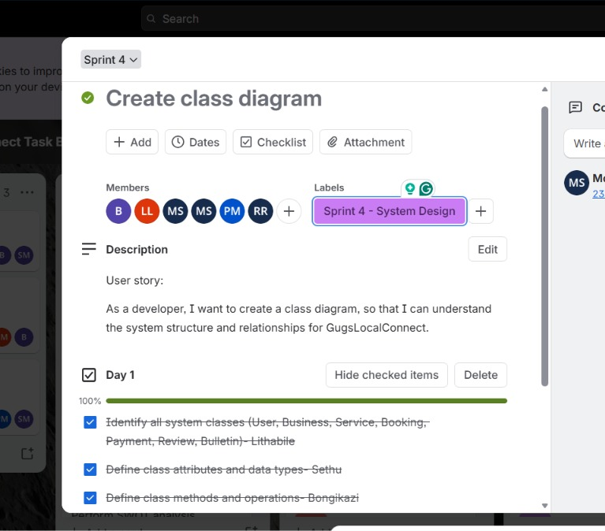
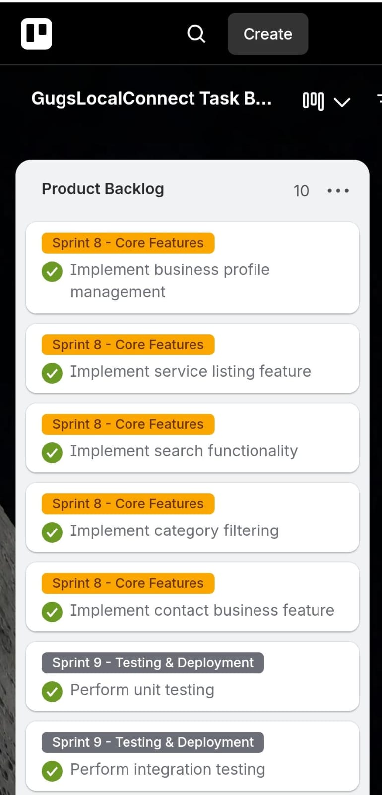
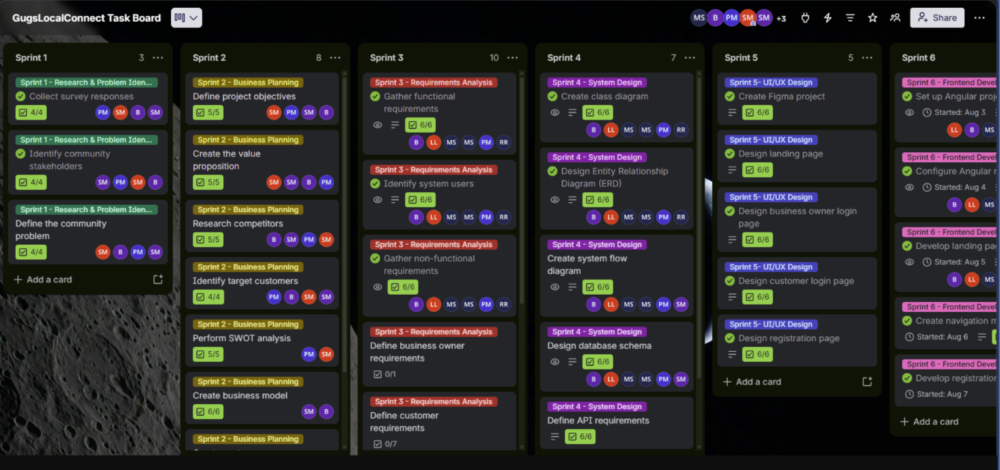

# Bongikazi Mnyamana – Digital Portfolio

Welcome to my digital portfolio. This portfolio presents my academic background, technical skills, projects and learning experiences as a Diploma in Information and Communication Technology (Applications Development) student at Cape Peninsula University of Technology (CPUT).

It also showcases my experience working as an Agile Lead on the GugsLocalConnect entrepreneurial project.

## Table of Contents

1. [Profile and CV](#profile-and-cv)
2. [CV Coded Using Markdown – Reflection](#cv-coded-using-markdown--reflection)
3. [Mock Interview Video](#mock-interview-video)
4. [Published on GitHub Pages](#published-on-github-pages)
5. [Agile Project Portfolio: GugsLocalConnect](#agile-project-portfolio-gugslocalconnect)
   - [Project Context](#project-context)
   - [Agile Team Charter](#agile-team-charter)
   - [User Stories and Tasks](#user-stories-and-tasks)
   - [Product Backlog](#product-backlog)
   - [Sprint Backlog](#sprint-backlog)
   - [Agile Logbook](#agile-logbook)
6. [Portfolio Summary](#portfolio-summary)

---

# Profile and CV

## GitHub Student Account

The following screenshot shows my GitHub student account.

**GitHub Username:** BongikaziMnyamana  
**GitHub Profile:** [View my GitHub Profile](https://github.com/BongikaziMnyamana)

---

# Bongikazi Malebu Mnyamana

- **Email:** 222718404@mycput.ac.za
- **Phone:** +27 69 533 0914
- **Location:** Cape Town, South Africa
- **GitHub:** [github.com/BongikaziMnyamana](https://github.com/BongikaziMnyamana)
- **LinkedIn:** [linkedin.com/in/bongikazi-mnyamana](https://www.linkedin.com/in/bongikazi-mnyamana)

## Education

**National Senior Certificate (Grade 12) – 2021**  
Cofimvaba Finishing School, Eastern Cape

**Higher Certificate in Information and Communication Technology**  
Cape Peninsula University of Technology

**Diploma in Information and Communication Technology (Applications Development) – Current**  
Cape Peninsula University of Technology, Cape Town

## Technical Skills

**Programming Languages:**

- Java
- Python
- JavaScript

**Web Technologies:**

- HTML
- CSS

**Databases:**

- MySQL
- Derby

**Tools and Technologies:**

- Git
- GitHub
- NetBeans
- Node.js

## Projects

### NGO Management System – Personal Project

- Developed a Java desktop application with MySQL integration using JDBC.
- Implemented secure authentication and CRUD operations.
- Built modules for managing members, donations, volunteers and beneficiaries.

### CPUT StudyConnect – Group Project

- Developed a Java Swing desktop application to help students create and join study sessions.
- Built graphical user interfaces using JTable and applied OOP and MVC architecture.
- Developed the Study Sessions and Ratings modules using Derby SQL and CRUD functionality.

### GugsLocalConnect – Group Project (Agile)

- Worked as the **Agile Lead** in a team of six on a community platform connecting Gugulethu residents with local businesses and service providers.
- Helped organise project work into sprints and track tasks using Trello.
- Live application: [View GugsLocalConnect](https://gug-local-connect1-ashen.vercel.app/)

### Personal Portfolio Website – Web Development Project

- Designed and developed a responsive website using HTML, CSS and JavaScript.
- Implemented interactive features and form validation.
- Focused on usability and responsive design.

## References

**Ms S’nazo Kamteni**  
Sports Coach  
Phone: +27 71 120 2142  
Email: snazok@gmail.com

**Mr Deric Sicetsha**  
Pastor  
Phone: +27 63 081 3190  
Email: esethudericsicetsha@gmail.com

---

# CV Coded Using Markdown – Reflection

**Situation:** As part of my PRP370 module, I was required to create a professional CV using Markdown language. This was my first time writing in Markdown, and I had no prior experience with its syntax or formatting conventions.

**Task:** My task was to produce a well-structured, visually clear CV that showcased my education, technical skills and projects, all coded in Markdown rather than a traditional word processor.

**Action:** I researched Markdown syntax, learning how to use headings (`#`), bold text (`**`), bullet points (`-`), horizontal rules (`---`) and inline formatting for links and icons. I structured the CV with clear sections and used emojis as visual anchors to make each section easy to identify. I also linked my GitHub and LinkedIn profiles directly in the header.

**Result:** I successfully produced a complete, professional CV in Markdown. I gained a new technical skill that is widely used in the software development industry, particularly for README files and documentation on GitHub. The experience improved my attention to formatting detail and gave me confidence in writing structured content using lightweight markup languages.

---

# Mock Interview Video

I recorded a mock interview as part of my PRP370 assessment. The video demonstrates how I introduce myself, communicate my background and respond to interview questions.

[**Watch My Mock Interview Video**](https://github.com/BongikaziMnyamana/BongikaziMnyamana.github.io/blob/main/Mock-interview-video.mp4)

### Mock Interview Video Reflection

**Situation:** As part of the assessment, I was required to record a mock interview video. I had to select interview questions that I felt comfortable answering, which gave me the opportunity to present myself authentically.

**Task:** My task was to choose suitable interview questions, prepare thoughtful answers and record a video that demonstrated my ability to communicate professionally and present my skills and background confidently.

**Action:** I selected questions that aligned with my personal experiences and technical background, such as questions about my projects, my strengths and why I chose application development. I prepared and practised my answers beforehand to ensure I spoke clearly and with confidence. I then recorded the video.

**Result:** The experience was both challenging and valuable. Recording myself helped me identify areas where I tend to rush or lose confidence, and practising beforehand made a noticeable difference. I came away with a better understanding of how to present myself in a professional interview setting, and the exercise built my self-awareness as a future job candidate in the IT industry.

---

# Published on GitHub Pages

My digital portfolio is live and published on GitHub Pages.

**Live Portfolio:** [Visit My Digital Portfolio](https://bongikazimnyamana.github.io/)

### GitHub Pages Evidence

### Published on GitHub Pages Reflection

**Situation:** This was my first time using GitHub, and I was required to not only create a GitHub account but also publish my digital portfolio on GitHub Pages. I had no prior experience with version control or deploying web content through GitHub.

**Task:** My task was to set up a GitHub student account, upload my portfolio content and successfully publish it as a live website using GitHub Pages.

**Action:** I started by creating my GitHub account and familiarising myself with the platform's interface. I learned how to create a repository, commit and push files, and configure the repository settings to enable GitHub Pages. I worked through errors and settings step by step, using available resources to guide me through the deployment process.

**Result:** I successfully published my digital portfolio on GitHub Pages. This was a significant achievement for me as a first-time GitHub user. Beyond completing the requirement, I now have a live, accessible portfolio that I can share with future employers. The experience introduced me to industry-standard version control practices and gave me a foundation to continue using GitHub for future academic and professional projects.

---

# Semester 2- Entrepreneurial WIL Project: GugsLocalConnect

## Project Context

GugsLocalConnect is a community platform that connects residents of Gugulethu with trusted local businesses and service providers. The aim is to make it easier for residents to find local services and help businesses improve their visibility in the community.

Our team consisted of six members who worked in Agile sprints and managed project tasks using Trello.

**My role was Agile Lead**, responsible for facilitating Agile meetings and encouraging teamwork and communication.

### Project Evidence and Links

- **Trello Task Board:** [View GugsLocalConnect Trello Board](https://trello.com/b/HIAaT2dR/gugslocalconnect-task-board)
- **Live Application:** [View GugsLocalConnect](https://gug-local-connect1-ashen.vercel.app/)
- **Frontend Repository:** [View Frontend Repository](https://github.com/BongikaziMnyamana/GugLocalConnect1)

---

# Agile Team Charter

## Evidence

The Agile Team Charter explains the purpose of GugsLocalConnect, the responsibilities of each team member, our team values, communication methods, meeting arrangements and project milestones.

**View the Agile Team Charter online:**

[Open Agile Team Charter in Document Viewer](https://docs.google.com/gview?embedded=1&url=https%3A%2F%2Fraw.githubusercontent.com%2FBongikaziMnyamana%2FBongikaziMnyamana.github.io%2Fmain%2FPRP3_TEAM_CHARTER..docx)

Our team values included collaboration, respect, transparency, accountability and continuous improvement. The charter also outlined our communication plan, which included daily stand-ups, a weekly sprint review and a sprint retrospective.

## Reflection

**Situation:** Our team of six was starting the GugsLocalConnect project and needed a shared agreement on how we would work together, who was responsible for what and how we would communicate.

**Task:** As Agile Lead, my task was to help the team follow the agreements in the charter, especially the meeting routine and keeping the Trello board updated.

**Action:** I helped organise and facilitate our team meetings on Microsoft Teams and used the WhatsApp group for quick updates and reminders.

**Result:** The charter gave the team a common direction and clear expectations for roles and communication.

**Learning and Next Time:** I learned that agreements only work if someone checks that they are being followed. If I wrote the charter again, I would make the agreements easier to keep, for example by agreeing on stand-up times that fit around everyone's timetables.

---

# User Stories and Tasks

## Evidence

The following screenshot shows our user stories and tasks organised on Trello.

[View User Stories and Tasks on Trello](https://trello.com/b/HIAaT2dR/gugslocalconnect-task-board)

Our team used Trello to record our user stories and turn each one into smaller tasks. Each task had a checklist and was assigned to a team member, so we knew who was responsible and what still needed to be done. This helped us keep our work focused on what customers and business owners needed from GugsLocalConnect.

Our two main user stories were:

1. **Customer:** As a customer, I want to browse local businesses and contact business owners, so that I can find trusted services in my community.
   - Related tasks: search functionality, category filtering and contact business feature.

2. **Business Owner:** As a business owner, I want to manage my business profile and services, so that customers can find my business online.
   - Related tasks: business profile management and service listing feature.

## Reflection

**Situation:** Our team needed to understand what users needed from the platform and divide the work in a way everyone could follow.

**Task:** As Agile Lead, I wanted to make sure the work was clear enough that every team member knew what they were responsible for.

**Action:** We described features as user stories and split each one into smaller tasks with checklists on Trello, assigned to team members.

**Result:** The checklists made progress easy to see, and most cards showed 6/6 or 4/4 once complete.

**Learning and Next Time:** I learned that a story is only useful if its tasks are small and specific. Next time I would write acceptance criteria for each story so that everyone agrees what "done" means.

---

# Product Backlog

## Evidence

The following screenshot shows our product backlog on Trello.

[View Product Backlog on Trello](https://trello.com/b/HIAaT2dR/gugslocalconnect-task-board)

Our product backlog on Trello holds all the features and testing work we needed to build GugsLocalConnect, grouped by sprint. The core features, including business profiles, service listings, search, category filtering and contacting a business, were planned for Sprint 8, followed by testing and deployment in Sprint 9.

Completed items are marked with a green tick, which helped the team see what was done and what was left. Our charter set the goal of completing all 28 backlog tasks.

## Sprint 8 – Core Features

1. Implement business profile management.
2. Implement service listing feature.
3. Implement search functionality.
4. Implement category filtering.
5. Implement contact business feature.

## Sprint 9 – Testing and Deployment

6. Perform unit testing.
7. Perform integration testing.
8. Complete further testing and deployment tasks.

## Reflection

**Situation:** The project had many requirements across research, design, frontend and backend work, and we could not do everything at once.

**Task:** As Agile Lead, I needed to help the team keep a clear, shared view of what had to be done and in what order.

**Action:** We kept all work as cards on Trello and grouped it by sprint, with the core features built in Sprint 8, followed by testing and deployment in Sprint 9.

**Result:** The backlog gave the team one place to see all the work, which made planning each sprint easier.

**Learning and Next Time:** I learned that the backlog needs regular review as requirements change. Next time I would review and re-order the backlog at every sprint review.

---

# Sprint Backlog

## Evidence

The following screenshot shows our team's sprint backlog and how tasks were organised into different stages.

[View Sprint Backlog on Trello](https://trello.com/b/HIAaT2dR/gugslocalconnect-task-board)

Our team used sprints on Trello to split the project into stages. Each card had a checklist and team members assigned to it, which allowed us to follow progress and see who was responsible. The board also showed where work was behind, for example two Sprint 3 requirements cards that had no completed tasks yet.

The sprints shown in our evidence were:

### Sprint 1 – Research and Problem Identification

- Collect survey responses.
- Identify community stakeholders.
- Define the community problem.

### Sprint 2 – Business Planning

- Define project objectives.
- Develop the value proposition.
- Research competitors.
- Complete a SWOT analysis.
- Develop the business model.

### Sprint 3 – Requirements Analysis

- Gather functional and non-functional requirements.
- Identify system users.
- Define business owner and customer requirements.

### Sprint 4 – System Design

- Create the class diagram.
- Create the Entity Relationship Diagram (ERD).
- Develop the system flow diagram.
- Design the database schema.
- Identify API requirements.

### Sprint 5 – UI/UX Design

- Create the Figma project.
- Design the landing page.
- Design login and registration pages.

### Sprint 6 – Frontend Development

- Set up the Angular project.
- Configure navigation and routing.
- Develop the landing page.
- Implement registration functionality.

### Sprint 8 – Core Features

- Business profile management.
- Service listing.
- Search functionality.
- Category filtering.
- Contact business feature.

### Sprint 9 – Testing and Deployment

- Unit testing.
- Integration testing.
- Further testing and deployment tasks.

## Reflection

**Situation:** Our team needed to break a large project into stages we could plan and finish one at a time.

**Task:** As Agile Lead, I needed to help the team plan each sprint and keep the board accurate so everyone could see progress.

**Action:** We grouped tasks by sprint, assigned them to team members and tracked checklist progress on Trello.

**Result:** Most cards were completed, but the board also showed work that was not finished, for example the Sprint 3 cards "Define business owner requirements" (0/1) and "Define customer requirements" (0/7).

**Learning and Next Time:** I learned that a sprint plan needs regular checking, because tasks can take longer than expected or depend on other work. Next time I would check the board before each stand-up and move late cards into the next sprint early.

---

# Agile Logbook

## Evidence

My Agile Logbook recorded my daily stand-ups, sprint planning and retrospective notes during the project.

[**View Agile Logbook (PDF)**](GugsLocalConnect_Agile_Logbook.pdf)

## Reflection

**Situation:** Our charter required daily stand-ups, a weekly review and a retrospective, and these needed to be recorded.

**Task:** As Agile Lead, I needed to keep track of what the team completed, what was planned and what was blocking us.

**Action:** I recorded progress, planned work and problems in my logbook and used Teams and WhatsApp to coordinate.

**Result:** The logbook helped me spot problems early and see how the team was progressing.

**Learning and Next Time:** I learned that short, regular records support accountability and continuous improvement. Next time I would write each entry straight after the meeting.

---

# Portfolio Summary

This portfolio shows how I worked as Agile Lead on GugsLocalConnect. The **Team Charter** set our purpose and agreements. **User stories** described what users needed, and the **Product Backlog** organised that work. The **Sprint Backlog** divided the project into stages we could plan and track on Trello, and my **Agile Logbook** recorded how the team progressed and improved.

Together, these sections show how I moved from understanding a community problem to working with a team to organise and develop a solution.

My earlier sections, including my Markdown CV, mock interview and GitHub Pages publication, demonstrate the technical and professional skills I developed alongside these Agile practices.
